# Agent Office

A live, cozy pixel office for [Claude Code](https://claude.com/claude-code). Claude and every subagent it starts get their own character and desk, and you watch them work, talk to each other and walk around while your session runs.







It draws in a pane next to your session in the Claude Code desktop app, and as live text rows in the terminal. It runs entirely on your machine from your session's events: it makes no model calls and uses no tokens.

## Install

At the prompt of a Claude Code terminal session:

```
/plugin install agent-office --marketplace GameGuyy/agent-office
```

Answer `y` to add the marketplace, then pick a scope. The office opens when your next session starts; `/office` opens it any time.

## What happens in the office

- **You have your own office**, a glass-walled corner room with a CEO name plate on your desk. When you send a prompt, it appears over your desk and Claude walks in to greet you.
- **Claude briefs new subagents at the whiteboard.** They come in through the door, gather round while Claude sketches the plan, then head to their desks one by one as each starts work.
- **Agents talk.** The lead briefs each subagent and they answer; an agent that opens a file a teammate just edited walks over to say so; a subagent that finishes walks to Claude's desk to report back. Everything said is also in the chat log under the picture.
- **Claude takes breaks.** With nothing to do, Claude sits on the couch with a coffee, looks out of the window and visits the water cooler.
- **Two floors.** Under the office, down a glass lift shaft, is the B1 server hall: every background task (a shell left running, a monitor, a workflow) lights up its own rack, labelled with how long it has run, and a workflow's agents are linked down to theirs. Animated lines show who is working for whom.
- **A power gauge** on the wall, a neon dial with a needle, shows how much of your usage window is spent and when it refills. Past 80% it runs amber; past 90% a red beacon starts turning with a "home soon" warning, and the rows under the picture count down to the reset.
- **Out of usage, everyone goes home.** When the limit is hit, the whole team walks out of the door one by one, and the picture becomes their neighbourhood: a home for each agent, Claude asleep recharging, the others on the sofa, cooking, gaming or reading. A sign says when they are back, its bar filling up to the reset; when usage comes back, so does the office.
- **It is a real place:** brick walls with windows, a lounge and coffee bar, a whiteboard charting tool calls per minute, a wall clock on your local time, and the street outside with traffic, cafés and lamps.
- **Day, dusk and night** follow your local clock, or pick one with the light button or `/office theme day|dusk|night|auto`.

## Commands

| Command | What it does |
| --- | --- |
| `/office` | Opens the office pane |
| `/office theme auto\|day\|dusk\|night` | Sets the light |
| `/office inspect` | Turns hover tooltips on the desks on or off |
| `/office cast` | Lists which character each agent type gets |
| `/office reset-cast` | Forgets the remembered characters |
| `/office homes [minutes]` | Previews everyone going home, back in that many minutes (90 by default) |
| `/office homes off` | Ends the preview: everyone comes back to the office |

## How it draws

The desktop pane draws the office as an SVG image, and replacing an image on screen can blink. So the picture only changes for things you would notice (someone arrives, sits down, finishes), never per tool call, and the pane stacks two pictures: a new one loads in the one out of sight and then comes to the front. Walks, chat bubbles and animations play out inside the picture on their own timers.

## Developing

The mod is plain TypeScript run by Claude Code's mod engine:

- `hooks/register.tsx`: the hooks (session events, tool calls, subagents, the pane)
- `hooks/iso.ts`: the isometric renderer
- `hooks/stage.ts`: the floor plan and who walks where
- `hooks/office.ts`: the cast and activity labels

Run it from a checkout with `claude --plugin-dir <this folder>`, and check it with:

```
claude plugin validate .
claude plugin test .
```

## License

[MIT](LICENSE)
